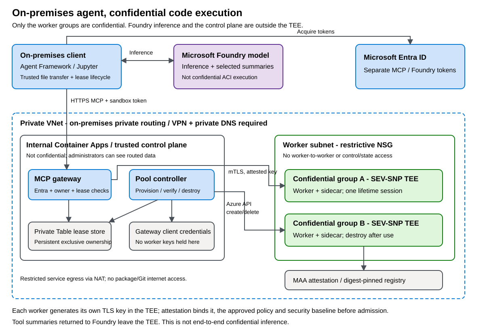
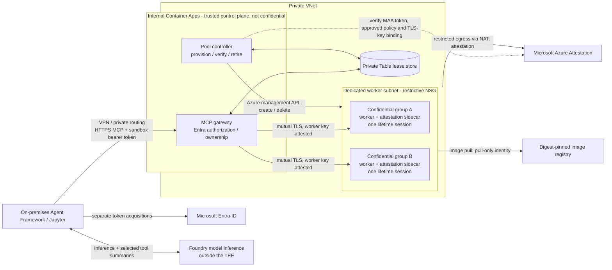

# Architecture

An on-premises agent uses Microsoft Foundry for inference and a private MCP
gateway for tool execution. Each session runs in a separate **confidential ACI
group (AMD SEV-SNP)**, containing a worker and an attestation sidecar. There is
no Foundry hosted agent or Foundry built-in code interpreter in this path.

[Editable Excalidraw source](images/architecture.excalidraw).
Resource names below describe roles, not a particular deployed environment.

## What the gateway is

The gateway is an **MCP server** that callers talk to. It is the only endpoint the
on-premises agent and the model ever see. It exposes the tools a session needs:
`create_session`, `get_session_status`, `list_sessions`, `delete_session`, the file
tools, `run_python`, `run_command`, `run_tests`, `pip_install`, `git_clone` and
`get_attestation`.

Toward the callers it acts as a server:

- It validates the caller's Entra token and checks that the caller owns the session on
  every call.
- Callers cannot supply a worker address or lease ID; the gateway chooses the worker
  that belongs to the session.

Toward the workers it acts as a client:

- Each worker is also an MCP server, but the gateway never calls its content tools in
  the clear. It verifies the worker's attestation, establishes a per-session key, and
  then sends every call as an encrypted message through the worker's single `invoke`
  tool. The worker decrypts it, runs the code and returns an encrypted result.

The gateway is **not** inside the confidential boundary. It sees plaintext for the data
it routes, which is the accepted trust boundary, and it keeps session keys only in
memory (so it runs as one replica, and a restart retires its sessions). The worker
group is the confidential part.

## What the pool controller is

The pool controller is a background service that manages the lifecycle of the workers.
It runs as its own internal Container Apps app with its own managed identity, separate
from the gateway, and it never sees user code, files or results. It works only from
the lease table and the Azure resource inventory, on a repeating **tick**:

- **Reserve and provision.** It keeps the configured number of warm workers and never
  exceeds the total cap. It reserves capacity in the table first, then creates each
  confidential group through the Azure management API, using the approved policy.
- **Verify before admission.** A new worker is not used until fresh MAA evidence shows
  the approved policy hash and security versions and is bound to the worker's own TLS
  key. Workers that fail are quarantined, not used.
- **Assign.** It pairs the oldest waiting session with a ready worker, in one
  transaction in the lease table.
- **Retire and delete.** Released, expired or failed sessions are retired and their
  worker group is deleted. A worker is never recycled. Capacity stays reserved until
  Azure confirms the deletion.
- **Reconcile.** It compares the table with the tagged groups that actually exist and
  repairs differences: missing, stuck, failed or half-deleted workers.
- **Expire the queue.** Queued sessions that wait past their deadline become `expired`.

A separate scheduled **orphan cleaner** job independently deletes old pool-tagged
groups that the controller lost track of, so one failure cannot leave workers running
indefinitely. The controller is trusted control-plane code outside the confidential
boundary, and its Azure permissions are narrowly scoped to the pool's resources.

## Request lifecycle

1. Trusted on-premises code obtains an Entra token for the sandbox API and calls
   `create_session`. The gateway records a lease owned by that principal.
2. The controller assigns a verified ready worker, or provisions a new worker
   within the total cap. The client polls `get_session_status`; queued is not ready.
3. The controller verifies fresh MAA evidence, approved CCE policy and security
   versions, bound to the worker TLS key, before admission.
4. Local code uploads the synthetic file. Agent tool closures bind this lease
   and submit code over MCP; the model cannot supply a worker URL or lease ID.
5. The gateway checks ownership/lease validity on every dispatch and uses mutual
   TLS to the worker. On first use it verifies fresh evidence that includes the
   worker's TEE-generated public key, generates a random 256-bit session key, and
   wraps it to that key. The worker accepts the key once; every content tool call
   then travels as an AES-256-GCM envelope (directional subkeys, increasing
   counter) through the worker's `invoke` tool. The key lives only in gateway and
   worker memory, so the gateway runs as a single replica and a restart retires
   its sessions. The model receives only the tool output returned by local code.
6. Local code downloads and validates the artifact, then releases the lease in
   `finally`. The controller destroys the used group; it is never recycled.

A request with unknown execution outcome is not replayed. A queued/expired
session or missing artifact is an error, not a success-shaped fallback.

## Authentication is not attestation

| Path | Credential / trust | Purpose |
|---|---|---|
| On-premises -> gateway | Entra token for `api://<sandbox-api-id>/.default`, role `Sandbox.Access`; pinned HTTPS certificate | Caller authorization and private encrypted ingress |
| On-premises -> Foundry | Separate `DefaultAzureCredential`, Foundry/model permissions | Inference; never reuse the sandbox token |
| Gateway -> worker | Worker TLS key generated inside the TEE and bound by MAA evidence; gateway client certificate | Mutual endpoint authentication without a controller-issued certificate |
| Controller <- worker evidence | MAA signature, nonce/TLS binding, policy hash, minimum SVN | Admission of approved confidential worker |
| Gateway <-> worker content | Per-session AES-256-GCM key wrapped to the attested TEE public key | Session-specific confidentiality, integrity and replay resistance beyond TLS |
| Controller -> Azure resources | Narrowly scoped managed identity | Provisioning, reconciliation, DNS and state |

The gateway validates Entra tenant, issuer, signature, audience, validity and
permissions. Ownership comes from token claims. One shared application identity
does **not** establish separate human owners. VPN access only supplies a route.

## What MAA is and how it is used

Microsoft Azure Attestation (MAA) is an Azure service that verifies hardware
attestation evidence and returns a signed token only when the evidence is valid.

- Each worker runs in an AMD SEV-SNP confidential container. The hardware
  produces a signed report of what is running: the policy hash and the
  firmware and security versions.
- MAA checks that report against Microsoft's trust roots and issues a signed
  token if it is valid.
- The gateway verifies the MAA token before sending any session data to a worker.
  The token must match the approved policy and meet the configured minimum
  security versions.
- The attestation challenge also binds the worker's TLS key fingerprint and its
  session public key to the evidence. This binding is what makes the attested
  TLS design work: the gateway trusts a key only because the hardware vouched
  for it.
- The deployment uses a shared regional MAA instance as the token issuer.

## Confidential and trusted boundaries

The **worker group** is the confidential boundary, not an individual process or
directory. Separate groups isolate separate analyses. The TEE protects memory
from the infrastructure host; code in the worker and authorized recipients still
see their data. Generated code runs as an unprivileged user with a scrubbed
environment and resource limits, which is hardening rather than a hostile-code
guarantee. See the README's administrator trust model for the accepted boundary.

The gateway, controller, PKI administrators, on-premises runtime and Foundry model
are outside the TEE. They are trusted for the data they handle. Returned tool
summaries leave the confidential boundary. `store=False` is a response-storage
setting, not a claim of zero service logging or retention.

## Components and networking

| Component | Implementation |
|---|---|
| MCP worker | `mcp-build-sandbox\server.py`, `pool_worker.py`; one lifetime session, required mTLS |
| Attestation sidecar | `mcr.microsoft.com/aci/skr`, used for evidence only; no secret release |
| Gateway/controller | `pool-control\`; separate identities in an internal Container Apps environment |
| Lease store | Private Entra-only Table storage; ETags and same-partition transactions |
| PKI | Gateway client CA and credentials only; each worker generates its own TLS key in the TEE, so no worker issuer exists |
| On-premises callers | `examples\pool_client.py`, scripts and notebooks |
| Infrastructure | `infra\pool\`; explicit existing-network, registry and attestation inputs |

Callers need VPN/ExpressRoute or equivalent routing plus private DNS. Workers
occupy a separate delegated subnet; its NSG permits control-to-worker TCP 8000
and denies worker-to-worker/control/state access. Only approved DNS and Azure
service egress is permitted. NAT supplies an outbound path, **not** an allowlist.
General-purpose package/Git egress is blocked.

Images are digest-pinned by the CCE policy. Worker source changes require an
image rebuild and approved policy regeneration. The pool uses no HSM or SKR;
the sidecar name does not mean an SKR path is enabled.

The current app template uses an ephemeral controller volume for policy and
deployment material. It holds no worker private keys.

## Azure resources

**Networking** (an existing virtual network):

- A Container Apps infrastructure subnet (`Microsoft.Network/virtualNetworks/subnets`),
  which hosts the gateway and controller.
- A worker subnet delegated to Azure Container Instances
  (`Microsoft.Network/virtualNetworks/subnets`, delegation `Microsoft.ContainerInstance/containerGroups`).
  Its NSG (`Microsoft.Network/networkSecurityGroups`) denies worker-to-worker,
  worker-to-control and worker-to-state traffic.
- A NAT gateway for restricted worker egress (`Microsoft.Network/natGateways`).
- Private DNS zones for the internal ingress and the worker hostnames
  (`Microsoft.Network/privateDnsZones`).
- VPN or ExpressRoute from on-premises (`Microsoft.Network/virtualNetworkGateways`
  or an ExpressRoute circuit, typically already in place). This supplies a route
  only; it does not authenticate callers.

**Control side:**

- A Container Apps environment, internal (`Microsoft.App/managedEnvironments`),
  with two apps, the gateway and the controller (`Microsoft.App/containerApps`).
- User-assigned managed identities for the gateway, the controller and the
  registry pull (`Microsoft.ManagedIdentity/userAssignedIdentities`).
- A private, Entra-only Azure Table storage account for the lease store
  (`Microsoft.Storage/storageAccounts`, Table service, with a private endpoint,
  `Microsoft.Network/privateEndpoints`).
- An Entra app registration for the API, with the `Sandbox.Access` app role
  (Microsoft Entra ID application, not an ARM resource).

**Workers:**

- Confidential ACI container groups (AMD SEV-SNP), created and deleted by the
  controller per session and never reused (`Microsoft.ContainerInstance/containerGroups`).
- The attestation sidecar, a second container in each worker group, used for
  evidence only. It is not a separate resource.

**Shared services:**

- Azure Container Registry for the worker, sidecar and controller images, with
  pull-only access through the pull identity (`Microsoft.ContainerRegistry/registries`).
- Microsoft Azure Attestation, using a regional endpoint (`Microsoft.Attestation/attestationProviders`
  for a private provider; a shared regional endpoint needs nothing to provision).
- Azure Policy, applied at the subscription level to constrain administrative
  access and what can be deployed (`Microsoft.Authorization/policyAssignments`).
  It is not deployed by this project.

**Role assignments** (`Microsoft.Authorization/roleAssignments`):

- The controller identity creates and deletes ACI groups and uses the table.
- The gateway identity uses the table.
- The pull identity has pull-only access to the registry.

## State of the implementation

The deployment has been validated live on the current build: the per-session
encrypted channel, cross-owner isolation and the hostile-code checks passed (see
the README's live check). Disruptive live fault injection, scale-up, reliable
client connectivity, load/failure behavior and production operations remain
release gates. The [requirements assessment](requirements-assessment.md) lists
the open items for sign-off. See [design](isolated-session-pool.md),
[setup](getting-started.md), [operations](operations.md) and
[cost assumptions](session-pool-costs.md).

