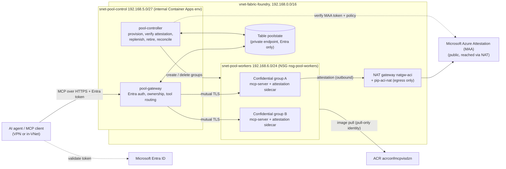

# Architecture

**Architecture:** [Confidential analysis session pool](isolated-session-pool.md)
(decisions, trust boundaries, rollout gates). Pricing is in
[pool cost estimates](session-pool-costs.md); onboarding is in
[getting started](getting-started.md) and the [pilot guide](pilot-guide.md).

A confidential code-interpreter that an AI agent drives over **MCP**. The agent
stays outside. Each analysis session runs in its **own Azure Container Instances
confidential container group** (AMD SEV-SNP TEE), so work is memory-encrypted,
hidden from the host/operator, and provable via attestation. A single private
**gateway** authenticates callers with Entra and routes each session to its
worker; a **controller** keeps a bounded pool of ready workers and destroys each
one after use.

## Diagram

The **TEE** protects each worker's memory from the infrastructure host. Code
inside a worker, and the gateway/controller/PKI administrators, remain trusted.
The gateway and controller are ordinary Container Apps, not confidential.

## Components

| Component | Location | Role |
|---|---|---|
| Worker (MCP server) | `mcp-build-sandbox\server.py`, `pool_worker.py` | FastMCP app serving exactly one lifetime session over mutual TLS; file and code-execution tools; `get_attestation` |
| Worker image | `mcp-build-sandbox\Dockerfile` | Python/pandas toolchain + worker |
| Attestation sidecar | `mcr.microsoft.com/aci/skr` | Produces SNP/MAA evidence at `localhost:8080`; used only for attestation, no key release |
| Gateway / controller | `pool-control\` | Entra-authenticated gateway, lease store access, controller, Azure adapter, PKI material |
| Pool infrastructure | `infra\pool\` | Bicep + scripts: subnets, NSG, identities, Table, DNS, environment, policy generation |
| Client examples | `examples\` | `pooled_analysis.py`, `pin_gateway_cert.py`, `pool_feasibility.py` |

### MCP tools

- **Sessions:** `create_session`, `get_session_status`, `list_sessions`, `delete_session`
- **Files:** `write_file`, `read_file`, `list_dir`, `upload_file`, `download_file`
- **Execution:** `run_python`, `run_command`, `run_tests` (`pip_install` and `git_clone` exist but fail: workers have no egress)
- **Attestation:** `get_attestation`

## Azure resources

- **VNet** `vnet-fabric-foundry` (192.168.0.0/16), shared; VPN gateway and DNS Private Resolver (192.168.1.36) for access and name resolution.
- **`snet-pool-control`** (192.168.5.0/27): internal Container Apps environment with `pool-gateway` and `pool-controller`.
- **`snet-pool-workers`** (192.168.6.0/24): delegated to `Microsoft.ContainerInstance/containerGroups`; one confidential group per session, private IP only. NSG `nsg-pool-workers` allows only the control subnet to reach TCP 8000 and denies worker-to-worker and worker-to-control traffic.
- **NAT gateway** `natgw-aci` + `pip-aci-nat`: egress-only path to MAA and ACR, which have no private path. It is not an egress allowlist.
- **Table storage** `poolstate`: leases and worker state; Entra-only, private endpoint, one partition so leasing can use transactions.
- **Identities:** `id-pool-gateway`, `id-pool-controller`, and the pull-only `id-pool-acrpull` (AcrPull on the registry only).
- **ACR** `acrconfmcpvisdzn`: worker image, pinned by digest in the CCE policy.
- **Private DNS:** `workers.pool.internal` (worker records) and the Container Apps environment zone.

## Authentication and attestation

- **Callers → gateway:** Entra access token (API app audience, role `Sandbox.Access`); ownership comes from validated claims.
- **Gateway → worker:** mutual TLS; workers hold a unique server cert, only the gateway-client issuer is trusted, and the CA signing key never enters a worker.
- **Worker → controller:** MAA attestation, bound to the worker's TLS key and a fresh challenge; the controller verifies the approved CCE policy and SVN minimums before any data is sent.
- **No HSM:** nothing is released to workers. See [Why no HSM](isolated-session-pool.md#why-no-hsm).
