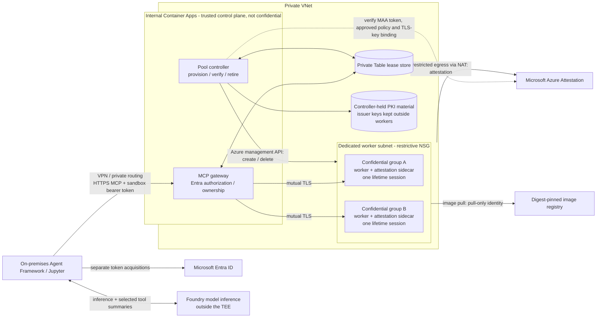

# Architecture

An on-premises agent uses Microsoft Foundry for inference and a private MCP
gateway for tool execution. Each session runs in a separate **confidential ACI
group (AMD SEV-SNP)**, containing a worker and an attestation sidecar. There is
no Foundry hosted agent or Foundry built-in code interpreter in this path.

[Editable Excalidraw source](images/architecture.excalidraw).
Resource names below describe roles, not a particular deployed environment.

## Request lifecycle

1. Trusted on-premises code obtains an Entra token for the sandbox API and calls
   `create_session`. The gateway records a lease owned by that principal.
2. The controller assigns a verified ready worker, or provisions a new worker
   within the total cap. The client polls `get_session_status`; queued is not ready.
3. The controller verifies fresh MAA evidence, approved CCE policy and security
   versions, bound to the worker TLS key, before admission.
4. Local code uploads the synthetic file. Agent tool closures bind this lease
   and submit code over MCP; the model cannot supply a worker URL or lease ID.
5. The gateway checks ownership/lease validity on every dispatch and uses mutual
   TLS to the worker. On first use it verifies fresh evidence that includes the
   worker's TEE-generated public key, generates a random 256-bit session key, and
   wraps it to that key. The worker accepts the key once; every content tool call
   then travels as an AES-256-GCM envelope (directional subkeys, increasing
   counter) through the worker's `invoke` tool. The key lives only in gateway and
   worker memory, so the gateway runs as a single replica and a restart retires
   its sessions. The model receives only the tool output returned by local code.
6. Local code downloads and validates the artifact, then releases the lease in
   `finally`. The controller destroys the used group; it is never recycled.

A request with unknown execution outcome is not replayed. A queued/expired
session or missing artifact is an error, not a success-shaped fallback.

## Authentication is not attestation

| Path | Credential / trust | Purpose |
|---|---|---|
| On-premises -> gateway | Entra token for `api://<sandbox-api-id>/.default`, role `Sandbox.Access`; pinned HTTPS certificate | Caller authorization and private encrypted ingress |
| On-premises -> Foundry | Separate `DefaultAzureCredential`, Foundry/model permissions | Inference; never reuse the sandbox token |
| Gateway -> worker | Per-worker TLS server certificate, gateway client certificate | Mutual endpoint authentication |
| Controller <- worker evidence | MAA signature, nonce/TLS binding, policy hash, minimum SVN | Admission of approved confidential worker |
| Gateway <-> worker content | Per-session AES-256-GCM key wrapped to the attested TEE public key | Session-specific confidentiality, integrity and replay resistance beyond TLS |
| Controller -> Azure resources | Narrowly scoped managed identity | Provisioning, reconciliation, DNS and state |

The gateway validates Entra tenant, issuer, signature, audience, validity and
permissions. Ownership comes from token claims. One shared application identity
does **not** establish separate human owners. VPN access only supplies a route.

## Confidential and trusted boundaries

The **worker group** is the confidential boundary, not an individual process or
directory. Separate groups isolate separate analyses. The TEE protects memory
from the infrastructure host; code in the worker and authorized recipients still
see their data. Generated code runs as an unprivileged user with a scrubbed
environment and resource limits, which is hardening rather than a hostile-code
guarantee. See the README's administrator trust model for the accepted boundary.

The gateway, controller, PKI administrators, on-premises runtime and Foundry model
are outside the TEE. They are trusted for the data they handle. Returned tool
summaries leave the confidential boundary. `store=False` is a response-storage
setting, not a claim of zero service logging or retention.

## Components and networking

| Component | Implementation |
|---|---|
| MCP worker | `mcp-build-sandbox\server.py`, `pool_worker.py`; one lifetime session, required mTLS |
| Attestation sidecar | `mcr.microsoft.com/aci/skr`, used for evidence only; no secret release |
| Gateway/controller | `pool-control\`; separate identities in an internal Container Apps environment |
| Lease store | Private Entra-only Table storage; ETags and same-partition transactions |
| PKI | Controller-held worker issuer; gateway-held client credentials; keys materialized at runtime |
| On-premises callers | `examples\pool_client.py`, scripts and notebooks |
| Infrastructure | `infra\pool\`; explicit existing-network, registry and attestation inputs |

Callers need VPN/ExpressRoute or equivalent routing plus private DNS. Workers
occupy a separate delegated subnet; its NSG permits control-to-worker TCP 8000
and denies worker-to-worker/control/state access. Only approved DNS and Azure
service egress is permitted. NAT supplies an outbound path, **not** an allowlist.
General-purpose package/Git egress is blocked.

Images are digest-pinned by the CCE policy. Worker source changes require an
image rebuild and approved policy regeneration. The pool uses no HSM or SKR;
the sidecar name does not mean an SKR path is enabled.

The current app template uses an ephemeral controller material volume.
Persistent material storage is not implemented; review the configured
secret/material lifecycle before production.

## State of the implementation

The deployment has been validated live on the current build: the per-session
encrypted channel, cross-owner isolation and the hostile-code checks passed (see
the README's live check). Disruptive live fault injection, scale-up, reliable
client connectivity, load/failure behavior and production operations remain
release gates. The [requirements assessment](requirements-assessment.md) lists
the open items for sign-off. See [design](isolated-session-pool.md),
[setup](getting-started.md), [operations](operations.md) and
[cost assumptions](session-pool-costs.md).
